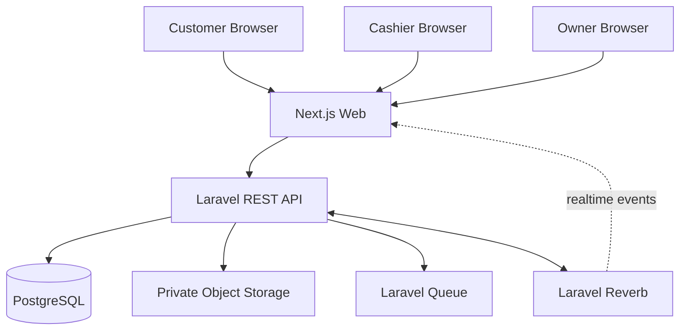
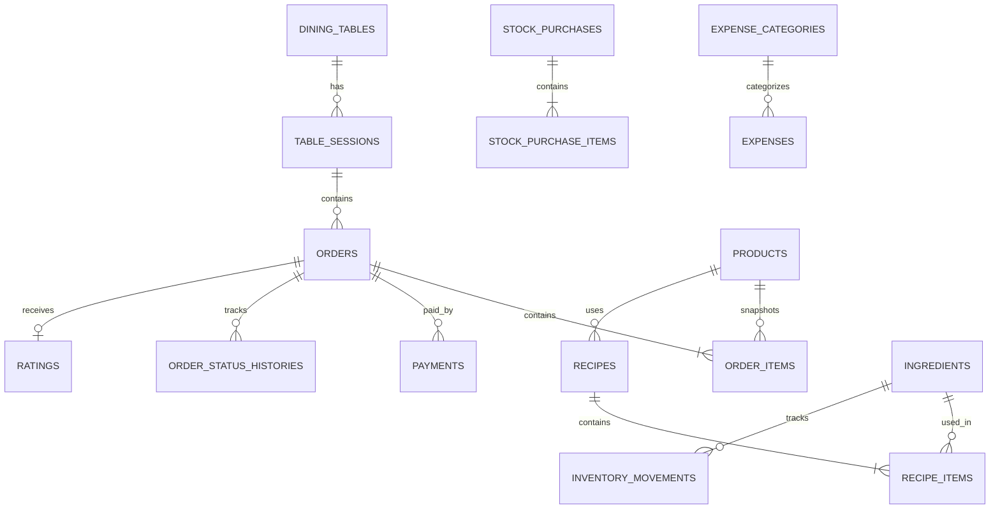

# Warkop Teras Nenek — System Architecture

**Version:** 1.0 | **Product:** Integrated QR Ordering, Cashier POS & Owner Management | **UI direction:** Rustic Modern

## 1. Product Overview

The system has three connected web experiences:

1. **Customer Ordering Website:** scan a table QR, browse menu, customize products, add a note per item, checkout with Cash or QRIS, and track the order. No mandatory customer account.
2. **Cashier Web App:** one queue for QR and manual POS orders, payment verification, order preparation status, expense entry, daily report, and cash closing.
3. **Owner Dashboard:** manage menu, 9 tables and QR codes, ingredients, recipes, purchases, stock opname, expenses, cash flow, daily employee reports, overall ratings, and traffic analytics.

## 2. Architecture Principles

- Backend is the source of truth for prices, totals, payment status, inventory, and permissions.
- Customer ordering is a first-class surface, not an afterthought to the cashier dashboard.
- QR and manual POS orders enter the same order domain and cashier queue.
- Preserve order-time snapshots so menu edits do not rewrite historical receipts.
- Use database transactions and idempotency for order, payment, and stock operations.
- Prefer simple, maintainable solutions over premature abstractions.
- Build for one outlet first; do not introduce multi-tenant complexity without a requirement.
- Never show fabricated analytics, ratings, or transactions as real data.

## 3. Recommended Technology Stack

| Layer | Recommendation | Responsibility |
|---|---|---|
| Frontend | Next.js + TypeScript | Customer, cashier, owner web |
| UI | Tailwind CSS + reusable components | Responsive design system |
| Backend | Laravel REST API | Business rules, auth, validation |
| Database | PostgreSQL | Relational data |
| Realtime | Laravel Reverb | Order and status updates |
| Background jobs | Laravel Queue | Notifications and exports |
| Charts | Recharts | Owner analytics |
| Storage | Private object storage | Payment evidence and attachments |
| Web server | Nginx + HTTPS | Reverse proxy and TLS |
| Hosting | VPS or managed hosting | Production runtime |

Use supported stable versions at implementation time. Check framework compatibility before pinning versions.

## 4. Suggested Repository Structure

Adapt to the repository that exists. Inspect before moving or replacing files.

```text
warkop-teras-nenek/
├── AGENT.md
├── ARCHITECTURE.md
├── README.md
├── apps/
│   ├── web/
│   │   ├── app/
│   │   │   ├── (customer)/t/[token]/
│   │   │   ├── (customer)/order/[publicCode]/
│   │   │   ├── (customer)/rating/[publicCode]/
│   │   │   ├── (auth)/login/
│   │   │   ├── (cashier)/cashier/
│   │   │   └── (owner)/owner/
│   │   ├── components/{ui,customer,cashier,owner}/
│   │   ├── features/{menu,ordering,payments,inventory,finance,reports,analytics}/
│   │   ├── lib/
│   │   └── tests/
│   └── api/                 # Laravel
├── packages/
│   ├── api-contracts/
│   └── shared-config/
└── docs/
    ├── DATA_MODEL.md
    └── DECISIONS.md
```

Do not migrate an existing project into a monorepo solely for aesthetic reasons.

## 5. Application Routes

### Customer
- `/t/[token]` — table-specific menu entry from QR.
- `/order/[publicCode]` — order status and summary.
- `/rating/[publicCode]` — rating after completion.

### Cashier
- `/login` — shared employee account authentication.
- `/cashier/orders` — unified order queue.
- `/cashier/orders/[id]` — order details and actions.
- `/cashier/pos` — manual order entry.
- `/cashier/payments` — payment verification/history.
- `/cashier/expenses` — operational expenses.
- `/cashier/daily-report` — daily employee report.
- `/cashier/closing` — cash closing.

### Owner
- `/owner` — overview.
- `/owner/orders` — transaction history.
- `/owner/menu` — categories, products, options.
- `/owner/tables` — 9 tables and QR management.
- `/owner/inventory/ingredients` — ingredient master.
- `/owner/inventory/recipes` — recipes.
- `/owner/inventory/movements` — stock movements.
- `/owner/inventory/purchases` — restocking.
- `/owner/inventory/stock-opname` — stock reconciliation.
- `/owner/finance` — cash flow.
- `/owner/expenses` — expense management.
- `/owner/reports` — employee reports.
- `/owner/ratings` — overall ratings.
- `/owner/analytics` — traffic analytics.
- `/owner/settings` — business settings.
- `/owner/audit-logs` — sensitive action history.

## 6. High-Level System Diagram



Realtime events notify clients that data changed. The API/database remains authoritative.

## 7. Core Domain Modules

### 7.1 Tables and QR
- Seed exactly 9 initial tables.
- Each table has a random, opaque, revocable QR token.
- Do not use a sequential table ID as the only security mechanism.
- QR regeneration invalidates the old token.
- Server resolves token to a table and manages the table session.
- A table session may contain multiple orders.
- Each order is paid independently in this version. Do not silently implement a shared table bill.

### 7.2 Menu and Product Customization
Entities: `categories`, `products`, `product_options`, `product_option_values`.
- Product availability can be toggled.
- Options may affect price.
- Item note is free text, maximum 250 characters.
- Save order-time snapshots: product name, unit price, selected options, option prices, and note.
- Historical order display must not change when the current menu is edited.

### 7.3 Orders
Entities: `orders`, `order_items`, `order_item_options`, `order_status_histories`.

Statuses: `PENDING_PAYMENT` → `CONFIRMED` → `PREPARING` → `READY` → `COMPLETED`; terminal alternative: `CANCELLED`.

Rules:
- Validate availability and current price on the server.
- Recalculate all totals on the server.
- Use idempotency keys for order creation.
- Validate every status transition.
- Store actor, timestamp, previous/next status, and reason where relevant.
- Cancelled orders remain in history.

### 7.4 Payments
Entities: `payments`, `cash_accounts`, `cash_transactions`.

Methods: Cash and static QRIS. Statuses: `UNPAID`, `PROOF_UPLOADED`, `VERIFYING`, `PAID`, `REJECTED`, `REFUNDED`.

Cash:
- Record amount received.
- Calculate change on the server.
- Reject insufficient tender.

Static QRIS:
- Show the official merchant QRIS configured by owner.
- An uploaded image or “I have paid” click is not proof of settlement.
- Cashier verifies against merchant-side evidence/process.
- Only authorized cashier action marks payment as paid.
- Store verifier identity and timestamp.
- Never claim automatic settlement without a real, verified provider integration.

### 7.5 Ingredient Inventory
Entities: `ingredients`, `ingredient_categories`, `recipes`, `recipe_items`, `inventory_movements`, `stock_adjustments`, `stock_purchases`, `stock_purchase_items`.

Rules:
- Every ingredient has a base unit; conversions are explicit.
- Recipes define ingredient quantity per product unit.
- Products without validated recipes must not deduct stock automatically.
- Inventory movement history is append-only.
- Use database transactions and row locks/atomic updates for deduction.
- Prevent negative stock during normal order processing.
- Restocking increases stock.
- Stock purchase is a cash outflow and inventory addition, not immediate full COGS.
- Preserve historical recipe/cost context.

**Decision to confirm before coding:** PRD recommends deducting stock after payment is accepted/verified. Keep the trigger centralized and confirm it before implementation.

### 7.6 Finance and Expenses
Entities: `expense_categories`, `expenses`, `cash_accounts`, `cash_transactions`, `cash_closings`.

Keep distinct:
- Sales revenue
- Refunds/discounts
- Ingredient purchases
- Ingredient consumption / COGS
- Operating expenses
- Cash/bank balances
- Cash closing variance

Cash balance is not profit. Avoid counting stock purchases and COGS twice.

### 7.7 Employee Daily Report
Entities: `employee_reports`, `employee_report_attachments`, `employee_sessions`.

Report includes shift/selected employee, system-generated order summary, business condition (busy/normal/quiet), stock concerns, operational issues, expenses, notes, optional attachments, review status, and owner feedback.

There is one shared employee login by product decision. Use shift identity selection and PIN confirmation for sensitive actions. Shared login is less attributable than individual accounts; do not hide this limitation.

### 7.8 Customer Rating
- Overall rating only, 1–5 stars.
- One rating per completed order.
- Optional comment.
- No product-level rating in this version.

### 7.9 Traffic Analytics
Track distinct events: menu/QR visit, order created, payment confirmed, order completed, order cancelled.

Metrics: orders and revenue by hour/day, average order value, product performance, busy/quiet periods, table utilization/session duration where data supports it.

Do not equate QR scans with verified visitor counts. Show date range and sample size. If history is insufficient, say so.

## 8. Initial Data Model



Additional entities: `users`, `employee_profiles`, `employee_sessions`, `categories`, `product_options`, `product_option_values`, `order_item_options`, `ingredient_categories`, `stock_adjustments`, `cash_accounts`, `cash_transactions`, `cash_closings`, `employee_report_attachments`, `notifications`, `system_settings`, `audit_logs`.

Use foreign keys, indexes, unique constraints for public codes/tokens, and database constraints where practical. Store money using integer rupiah or fixed decimal consistently; never floating-point currency.

## 9. API Conventions

Prefix: `/api/v1`.

Public:
- `GET /public/tables/{token}/menu`
- `POST /public/orders`
- `GET /public/orders/{publicCode}`
- `POST /public/orders/{publicCode}/payment-proof`
- `POST /public/orders/{publicCode}/rating`

Cashier:
- `GET /cashier/orders`
- `GET /cashier/orders/{id}`
- `PATCH /cashier/orders/{id}/status`
- `POST /cashier/orders/{id}/payments`
- `POST /cashier/pos/orders`
- `POST /cashier/expenses`
- `POST /cashier/daily-reports`
- `POST /cashier/closings`

Owner:
- `GET /owner/dashboard`
- CRUD `/owner/products`
- CRUD `/owner/ingredients`
- CRUD `/owner/recipes`
- CRUD `/owner/expenses`
- `GET /owner/finance/cash-flow`
- `GET /owner/analytics/traffic`
- `GET /owner/audit-logs`

API requirements:
- Backend validation, consistent errors, pagination, date/status filters.
- Backend authorization policies.
- Rate-limit public order and upload endpoints.
- Idempotency for order/payment-sensitive operations.
- Do not expose internal sequential IDs as public authorization tokens.

## 10. Authentication and Authorization

- Customer: no account; opaque QR token and unguessable public order code.
- Employee: shared account; select identity per shift.
- Owner: privileged account.
- Require PIN/reauthentication for refunds, post-confirmation cancellations, stock adjustments, and cash closing overrides.
- Audit sensitive actions with actor, role/session, timestamp, entity, and change summary.
- Enforce authorization in backend policies/middleware, not only frontend route guards.

## 11. Realtime

Use Laravel Reverb for new order notifications, customer status updates, and relevant payment updates. Use modest polling as fallback. Show connection state in cashier UI. Re-fetch authoritative data from API; never treat websocket payload as the sole source of truth.

## 12. Rustic Modern UI Direction

Palette:
- Espresso Brown `#3B2922`
- Dark Walnut `#5A4032`
- Warm Cream `#F6F0E6`
- Sand Beige `#D9C5AA`
- Terracotta `#B76E4B`
- Olive `#69735A`
- Charcoal `#292724`

Typography: Plus Jakarta Sans, Inter, or DM Sans.

Requirements:
- Warm, natural, contemporary, legible.
- Customer mobile-first; cashier optimized for speed; owner dashboard optimized for scanning business status.
- Consistent real food photography.
- Strong loading, empty, error, success, and offline states.
- Accessible contrast and keyboard navigation.
- Avoid generic AI dashboard aesthetics, excessive cards/dividers, random gradients, glassmorphism, glow, neon, ornamental clutter, and arbitrary animations.
- Never use fabricated data in charts.

Mandatory customer screens:
1. Table-specific QR menu
2. Category browsing/search
3. Product detail/options
4. Per-item note
5. Cart
6. Checkout/payment choice
7. QRIS/cash instructions
8. Order confirmation
9. Order tracking
10. Completion/rating

Cashier screens: login/shift identity, unified queue, order detail, payment confirmation, QRIS verification, manual POS, transaction history, expense entry, daily report, cash closing.

Owner screens: overview, orders, menu, tables/QR, ingredients, recipes, movements, purchases, stock opname, finance, expenses, employee reports, ratings, analytics, settings, audit logs.

## 13. Non-Functional Targets

- Menu usable within 3 seconds on normal connection.
- Common operational API p95 target: 800 ms under agreed initial load.
- New order visible to cashier within 5 seconds on normal connection.
- Initial monthly availability target: 99%, excluding planned maintenance.
- Daily database backup and tested restore procedure.
- Responsive customer mobile, cashier tablet/desktop, owner desktop/mobile.
- No duplicate payment or stock deduction caused by retries.
- Sensitive actions auditable.

Treat these as test targets, not guarantees.

## 14. Implementation Sequence

1. Inspect repository, versions, current features, and installed skills.
2. Establish auth, database, API conventions, and design tokens.
3. Build 9-table QR foundation and menu.
4. Build complete customer ordering.
5. Build unified cashier queue and manual POS.
6. Implement cash and manual QRIS verification.
7. Implement ingredients, recipes, stock movements, purchases.
8. Implement expenses, cash flow, closing.
9. Implement daily reports and ratings.
10. Implement owner dashboard and traffic analytics.
11. Add audit logs, exports, tests, backups, and deployment hardening.

Do not polish secondary dashboard features before customer ordering works end-to-end.

## 15. Definition of Done

A feature is done only when it meets requirements, works end-to-end with real API/database behavior, has backend validation and authorization, handles loading/empty/error/success/offline states, is responsive and accessible, has relevant tests, presents no fake data as real, and does not break unrelated functionality.
